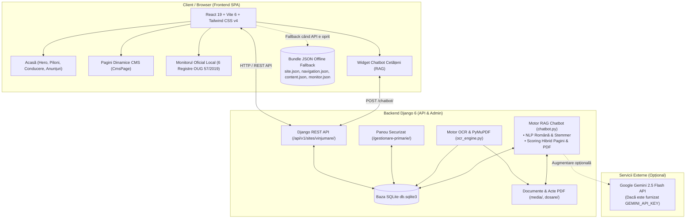

# Plan de Refacere: Primăria Orașului Vânju Mare (`primariavinjumare.ro`)
**Referință arhitecturală:** `comunacorcova.ro`  
**Sursă de date:** Arhiva web Wayback Machine (`https://web.archive.org/web/20260821082801/https://primariavinjumare.ro/`)  
**Data elaborării:** 04 Noiembrie 2026  
**Status:** În faza de aprobare / planificare

---

## 1. Obiectivul Proiectului

Reconstrucția completă și modernizarea platformei web a **Primăriei Orașului Vânju Mare** (`primariavinjumare.ro`), utilizând **exact aceeași arhitectură tehnică modernă, performantă și securizată** dezvoltată pentru `comunacorcova.ro`, populată în totalitate cu **informațiile, structura administrativă, paginile, documentele și identitatea oficială preluate din arhiva primăriei**.

### Principii Cheie
1. **Fidelitate arhitecturală 1:1 față de modelul Corcova:**
   - Frontend modern SPA în React 19 + Vite 6 + Tailwind CSS v4.
   - Arhitectură duală (online cu API Django REST + mod standalone complet offline pe bază de fișiere JSON pre-generate).
   - Backend robust în Django 6 + SQLite cu panou de administrare dedicat (`/gestionare-primarie/`).
   - Modul complet de **Monitor Oficial Local** structurat pe cele 6 registre obligatorii conform Codului Administrativ (OUG 57/2019).
   - **Asistent virtual inteligent pentru cetățeni bazat pe RAG (Retrieval-Augmented Generation)** cu căutare semantică în pagini și text extras OCR din actele oficiale scanate/PDF, funcțional atât cu Google Gemini API cât și cu motor determinist local (fără costuri / offline).
2. **Fidelitate a conținutului:** Integrarea tuturor datelor oficiale din arhiva Vânju Mare (conducere, departamente, consiliu local, formulare de asistență socială, anunțuri, registre de hotărâri și dispoziții).

---

## 2. Analiza Comparativă a Modelului de Referință (`comunacorcova.ro`)

În urma analizării directe a structurii `comunacorcova.ro`, au fost identificate componentele care vor fi replicate pentru Vânju Mare:

### 2.1. Structura Frontend (`frontend/`)
- **Tehnologii:** React 19, Vite 6, Tailwind CSS v4, Lucide React, DOMPurify, Playwright.
- **Nucleul aplicației:**
  - `main.jsx`: Componenta rădăcină, rutare SPA (`routing.js`), antet cu stemă și identitate tricoloră, meniu de navigare adaptiv, subsol instituțional, modal de căutare globală și formular de contact.
  - `home.jsx`: Pagina principală ce include:
    - *Hero Section* (titlu dinamic, prezentare, acțiuni rapide).
    - *Quick Links* (scurtături vizuale către formulare, asistență socială, Monitorul Oficial Local, conducere).
    - `CommunityPillars.jsx`: Cei 4 piloni de dezvoltare comunitară, priorități strategice & finanțe publice și secțiunea de conducere executivă (Primar, Viceprimar, Secretar, etc.).
    - *Anunțuri & Documente recente* (feed de noutăți cu filtrare și descărcare directă).
  - `cms.jsx`: Motorul de redare al paginilor instituționale, navigare recursivă în subpagini, descărcare atașamente, căutare în conținut (`ApiSearch`).
  - `components/MonitorLocal.jsx`: Implementarea Monitorului Oficial Local conform OUG 57/2019 (filtrare după registru, an, număr act, căutare text și previzualizare/descărcare PDF).
  - `components/AnnouncementsView.jsx`: Vizualizarea anunțurilor administrative pe categorii (concursuri, achiziții, diverse).
  - `components/Chatbot.jsx`: Widget de asistență virtuală pentru cetățeni, cu sugestii rapide, citare surse din documente și linkuri directe către formulare.
  - `components/PageGallery.jsx` & `mediaData.js`: Galerii foto tematice (geografie, istorie, infrastructură, agricultură/viticultură).
  - `api.js`: Client API inteligent care interoghează backend-ul Django (`/api/v1/sites/vinjumare/...`) și comută automat pe fișierele locale JSON dacă backend-ul nu este activ.
- **Date statice locale (offline fallback):**
  - `site.json` — Date generale ale instituției (nume, adresă, email, telefon, configurare hero și scurtături).
  - `navigation.json` — Ierarhia completă a meniului principal.
  - `content.json` — Corpul tuturor paginilor și articolelor.
  - `documents.json` — Nomenclatorul actelor oficiale și linkurile de descărcare.
  - `monitor.json` — Registrele și actele Monitorului Oficial Local.
  - `presentation.json` — Textele promoționale și pilonii strategici.

### 2.2. Structura Backend (`backend/`)
- **Tehnologii:** Python 3.12+ / 3.14, Django 6.0, Django REST Framework, WhiteNoise, PyMuPDF (`fitz`), `google-genai`, `psycopg2-binary` (sau SQLite), `django-axes` (protecție brute-force).
- **Aplicații Django:**
  - `civic_core`:
    - Modele: `Institution`, `Section`, `Page`, `Menu`, `MenuItem`, `ContactMessage`.
    - API REST endpoints: `/api/v1/sites/<slug>/`, `/navigation/`, `/pages/`, `/contact/`, `/chatbot/`.
    - `chatbot.py`: Motorul de căutare hibridă (NLP română: eliminare diacritice, stemmer morfologic, scoring de relevanță, sinteză răspuns prin Gemini 2.5 Flash sau generator determinist offline).
  - `documents`:
    - Modele: `Category`, `Document`, `PageDocument`.
    - `ocr_engine.py`: Extragerea automată a textului din PDF-uri vectoriale sau scanate prin PyMuPDF și stocarea în câmpul `extracted_text`.
    - Management command: `index_pdf_texts.py` pentru re-indexarea arhivei.
  - `local_monitor`:
    - Modele: `Register` (cele 6 registre din OUG 57/2019), `Entry` (număr act, titlu, dată emitere, an, fișier atașat).
    - API REST endpoints: `/monitor/registers/`, `/monitor/entries/`.
  - `wordpress_import`:
    - `sql_reader.py` & `import_wordpress.py`: Instrumente pentru parsarea tabelelor WordPress (`wp_posts`, `wp_postmeta`, `wp_terms`) fără executare directă SQL.
- **Baza de date:** `db.sqlite3` gata populată și configurată.
- **Fișiere media:** `media/` și `dosare/` pentru PDF-uri, formulare, hotărâri și imagini.

---

## 3. Datele Extrase din Arhiva `primariavinjumare.ro`

Din analiza arhivei Wayback Machine (`https://web.archive.org/web/20260821082801/https://primariavinjumare.ro/`) au fost extrase următoarele informații oficiale specifice:

### 3.1. Identitate Instituțională & Contact
| Element | Valoare Oficială |
| :--- | :--- |
| **Denumire Instituție** | **Primăria Orașului Vânju Mare** (U.A.T. Vânju Mare) |
| **Județ** | Județul Mehedinți |
| **Adresă sediu** | Str. Rahovei, nr. 8, cod poștal 225400, Orașul Vânju Mare, Județul Mehedinți |
| **Telefon centrală** | `0252-350660` |
| **Fax** | `0252-350097` |
| **E-mail oficial** | `primariavinjumare@yahoo.com` |
| **Program Relații cu Publicul** | Luni – Joi: 08:00 – 16:00, Vineri: 08:00 – 14:00 (Direcția Impozite și Taxe – Registratură) |
| **Stemă & Simboluri** | Stema oficială a Orașului Vânju Mare (viță de vie / strugure de aur, specific Podgoriei Vânju Mare) + Stema Județului Mehedinți (`logo_mehedinti.png`) |

### 3.2. Conducerea Executivă & Reprezentanți Oficiali
| Funcție | Nume și Titulatură Oficială | Detalii & Program Audiențe |
| :--- | :--- | :--- |
| **Primar** | **Av. MIJAICHE ALEXANDRU** | Luni, Miercuri, Vineri: 09:00 – 11:00 |
| **Viceprimar** | **Ec. TIŢA SAMUEL – EDUARD** | Marți, Joi: 09:00 – 11:00 |
| **Secretar General** | **Jr. SÎRBU-CREŢU ELENA-ADINA** | Coordonare legalitate și aparatul de specialitate |
| **Consiliul Local** | **Consiliul Local al Orașului Vânju Mare** | Regulament intern, comisii de specialitate, rapoarte de activitate |

### 3.3. Structura Arborelui de Navigare (Meniul Principal)
Meniul principal extras din arhivă include 11 secțiuni principale și zeci de subpagini tematice:

1. **Acasă** (`/`)
2. **Primăria** (`/primaria-vinju-mare`)
   - *Organigrama* (`/organigrama-primariei-orasului-vinju-mare`)
   - *Audiențe* (`/audiente`)
   - *Primar* (`/primar`)
   - *Viceprimar* (`/viceprimar`)
   - *Secretar General* (`/secretar`)
3. **Consiliul Local** (`/consiliul-local-vinju-mare`)
   - *Regulament de Organizare și Funcționare* (`/regulament`)
   - *Consilieri locali* (`/consilieri-locali`)
   - *Hotărâri Consiliul Local (HCL)* (`/hotarari-consiliul-local`)
   - *Procese verbale Consiliul Local* (`/procese-verbale-consiliul-local`)
   - *Comisii de specialitate* (`/comisii-de-specialitate`)
   - *Rapoartele de activitate ale consilierilor locali* (`/rapoartele-de-activitate`)
4. **Informații Publice** (`/informatii-publice`)
   - *Strategia de dezvoltare locală* (`/strategia-de-dezvoltare`)
   - *Buget local & Finanțe* (`/buget`)
   - *Ștat de funcții* (`/stat-de-functii`)
   - *Formulare & Tipizate* (`/formulare`, `/tipizate`)
   - *Compartimentul de Asistență Socială* (Grup complet de 11 prestații):
     - Alocație de susținere a familiei
     - Venit minim garantat
     - Ajutor încălzire
     - Alocație de stat pentru copii
     - Documente HG 691/2015
     - Asistență handicap adulți
     - Asistență handicap copii
     - Indemnizație creștere copil
     - Stimulent de inserție
     - Stimulent educațional (tichet social grădiniță)
     - Tichete sociale pe suport electronic
   - *Investiții* (`/investitii`)
   - *Raportul anual privind starea economico-socială* (`/raportul-anual`)
   - *Relații cu publicul & Adrese utile* (`/relatii-cu-publicul`, `/adrese-utile`)
   - *Prelucrarea și protecția datelor cu caracter personal (GDPR)* (`/protectia-datelor`)
5. **Anunțuri Administrative** i(`/anunturi`)
   - *Anunțuri concesionări, închirieri, vânzări*
   - *Anunțuri concursuri și examene de angajare*
   - *Anunțuri diverse & Comunicări prin publicitate*
   - *Anunțuri achiziții publice*
6. **Dezvoltare Locală** (`/dezvoltare`)
   - *Agricultură & Viticultură* (zona viticolă Vânju Mare)
   - *Parteneri instituționali și privați*
   - *Proiecte investiționale & Fonduri Europene*
7. **Monitorul Oficial Local** (`/monitorul-oficial-local`)
   - *I. Statutul Unității Administrativ-Teritoriale*
   - *II. Regulamentele privind procedurile administrative*
   - *III. Hotărârile autorității deliberative (HCL)*
   - *IV. Dispozițiile autorității executive (Dispoziții Primar)*
   - *V. Documente și informații financiare (Bugete, execuție, audit)*
   - *VI. Alte documente de interes public*
8. **D.A.I (Declarații de Avere și Declarații de Interese)** (`/d-a-i`)
   - *Declarații de avere (conducere și consilieri)*
   - *Declarații de interese*
9. **Alegeri Locale & Naționale** (`/alegeri-2024`)
10. **Salubrizare & Protecția Mediului** (`/salubrizare`, `/colectare-selectiva`)
11. **Contact & Audiențe** (`/contact`)

---

## 4. Arhitectura de Ansamblu a Noului Site



---

## 5. Planul de Implementare Pas cu Pas (Faze și Activități)

### Faza 1: Extragerea și Descărcarea Datelor din Arhivă (Scraper & Asset Pipeline)
- **1.1. Script de descărcare a conținutului:**
  - Crearea unui crawler Python `scratch/scrape_vinjumare.py` adaptat rate-limiting-ului Wayback Machine (interval de 2–3 secunde între cereri, tratare erori HTTP 429 cu exponential backoff).
  - Descărcarea recursivă a paginilor HTML din arborele de navigare stabilit.
- **1.2. Descărcarea documentelor și a fișierelor media:**
  - Extragerea PDF-urilor (hotărâri, formulare de asistență socială, declarații de avere, bugete) și salvarea lor în `backend/media/vinjumare/` și `dosare/`.
  - Descărcarea imaginilor principale: fotografia oficială a sediului primăriei (`WhatsApp-Image-2021-01-22-at-15.01.28-665x430.jpeg`), organigrama oficială (`0RGANIGRAMA-vinjumare.jpg`), stema locală.
- **1.3. Normalizarea conținutului:**
  - Curățarea HTML-ului extras: eliminarea claselor specifice WordPress, eliminarea stilurilor inline inutile, transformarea linkurilor vechi în rute SPA curate (`#/pagina`).

### Faza 2: Inițializarea și Configurarea Structurii de Proiect în Workspace
- **2.1. Replicarea structurii de foldere:**
  - În `c:\Users\Nedelcu\Downloads\vinjumare`, inițializarea celor două mari subsisteme:
    - `backend/` (Django 6, Django REST Framework).
    - `frontend/` (React 19, Vite 6, Tailwind CSS v4).
- **2.2. Configurarea Backend-ului:**
  - Copierea și adaptarea configurațiilor din Corcova:
    - `backend/config/settings.py` (adaptare `ALLOWED_HOSTS`, `CSRF_TRUSTED_ORIGINS`, `INSTALLED_APPS`, setări baze de date SQLite, WhiteNoise, stocare media).
    - Aplicațiile `civic_core`, `documents`, `local_monitor`.
    - Fișierele `requirements.txt` și `pyproject.toml`.
  - Rularea migrațiilor Django: `python manage.py migrate`.
  - Crearea superutilizatorului de administrare locală prin `python manage.py create_local_admin`.

### Faza 3: Popularea Bazei de Date și Generarea Fișierelor JSON Fallback
- **3.1. Script de import și populare (`backend/civic_core/management/commands/import_vinjumare.py`):**
  - Crearea obiectului `Institution`:
    - `name = "Primăria Orașului Vânju Mare"`
    - `slug = "vinjumare"`
    - `county = "Mehedinți"`
    - `address = "Str. Rahovei, nr. 8, cod poștal 225400, Orașul Vânju Mare, Județul Mehedinți"`
    - `email = "primariavinjumare@yahoo.com"`
    - `phone = "0252 350 660"`
    - `fax = "0252 350 097"`
    - `presentation` JSON configurat cu pilonii specifici Vânju Mare (Viticultură & Agricultură, Infrastructură orășenească, Asistență socială și sprijin cetățeni, Transparență și digitalizare).
  - Crearea ierarhiei `Menu` și `MenuItem` pentru cele 11 ramuri și subramuri.
  - Crearea secțiunilor (`Section`) și paginilor (`Page`) cu conținutul curățat.
  - Crearea registrelor (`Register`) pentru Monitorul Oficial Local și a intrărilor (`Entry`) corelate cu fișierele PDF descărcate.
  - Înregistrarea documentelor în `documents_document` și maparea lor pe pagini prin `PageDocument`.
- **3.2. Indexarea textului din PDF-uri:**
  - Rularea `python manage.py index_pdf_texts` pentru extragerea textului din toate actele PDF încărcate, pentru căutare rapidă și funcționarea asistentului RAG.
- **3.3. Exportul bundle-urilor JSON de fallback pentru Frontend:**
  - Generarea automată a fișierelor:
    - `frontend/src/site.json`
    - `frontend/src/navigation.json`
    - `frontend/src/content.json`
    - `frontend/src/documents.json`
    - `frontend/src/monitor.json`
    - `frontend/src/presentation.json`

### Faza 4: Personalizarea și Construirea Frontend-ului React
- **4.1. Adaptarea componentelor de bază:**
  - `main.jsx`: Actualizarea titlurilor instituționale:
    - `Primăria Orașului Vânju Mare`
    - `JUDEȚUL MEHEDINȚI`
    - Stema orașului Vânju Mare și logo județ Mehedinți (`logo_mehedinti.png`).
  - `api.js`: Setare `siteSlug = 'vinjumare'`.
  - `home.jsx`:
    - Integrarea hero section cu mesaj specific Vânju Mare: *"Orașul Vinului și Tradiției Mehedințene"*.
    - Scurtături rapide către: Formulare Tipizate, Compartiment Asistență Socială, Monitorul Oficial Local, Conducerea Primăriei.
  - `components/CommunityPillars.jsx` & `mediaData.js`:
    - **Pilonul 1:** *Tradiție Viticolă & Agricultură Modernă* (Podgoria Vânju Mare, asociații agricole, sprijin fermieri).
    - **Pilonul 2:** *Dezvoltare Urbană & Infrastructură* (modernizare străzi, iluminat public, rețele utilități).
    - **Pilonul 3:** *Servicii Sociale & Comunitare* (alocații, ajutoare încălzire, tichete sociale, protecția copilului și a persoanelor vulnerabile).
    - **Pilonul 4:** *Transparență Administrativă & Digitalizare* (Monitor Oficial Local, hotărâri de consiliu, dispoziții primar, accesibilitate acte).
    - **Conducerea Executivă:**
      - *Primar:* Av. MIJAICHE ALEXANDRU.
      - *Viceprimar:* Ec. TIŢA SAMUEL – EDUARD.
      - *Secretar General:* Jr. SÎRBU-CREŢU ELENA-ADINA.
  - `components/MonitorLocal.jsx`: Conectat direct la registrele și actele Vânju Mare.
  - `components/Chatbot.jsx`: Conectat la endpoint-ul Vânju Mare, cu sugestii rapide adaptate:
    - *„Cine este primarul orașului Vânju Mare?”*
    - *„Care sunt orele de audiență la primar și viceprimar?”*
    - *„Ce acte sunt necesare pentru ajutorul de încălzire?”*
    - *„Cum pot consulta ultimele hotărâri de consiliu local?”*
    - *„Care este adresa și programul de lucru cu publicul?”*

### Faza 5: Personalizarea Asistentului Virtual & RAG Chatbot
- **5.1. Actualizare `backend/civic_core/chatbot.py`:**
  - `get_contact_response()`: Adresă (Str. Rahovei nr. 8), telefon `0252-350660`, fax `0252-350097`, email `primariavinjumare@yahoo.com`.
  - `get_leadership_response()`: Datele de identificare ale conducerii executive a orașului Vânju Mare.
  - `build_prompt()`: Instrucțiuni de sistem specifice instituției:
    - Rol: Asistentul Virtual Oficial al Primăriei Orașului Vânju Mare, Județul Mehedinți.
    - Ton instituțional, precis, orientat către cetățeni, bazat exclusiv pe actele și paginile primăriei.

### Faza 6: Verificare, Audit și Asigurarea Calității (QA)
- **6.1. Verificare Frontend:**
  - Build de producție Vite: `npm run build`.
  - Audit dependențe și fișiere nefolosite: `npm run audit:knip` și `npm run audit:madge`.
  - Teste automate Playwright: validare navigare pe toate cele 11 secțiuni, deschidere pagini dinamice, descărcare documente, funcționare filtre Monitor Oficial Local și modal de contact.
- **6.2. Verificare Backend:**
  - Rulare verificări de conformitate Django: `python manage.py check --deploy`.
  - Verificare calitate cod: `ruff check .`.
  - Verificare endpoint-uri API REST prin teste unitare.
- **6.3. Testare Asistent Virtual (RAG):**
  - Rulare teste automate pentru modul offline determinist (fără API key).
  - Testare răspunsuri cu modelul `gemini-2.5-flash` prin `GEMINI_API_KEY`.

### Faza 7: Livrare și Documentație
- `README.md` complet cu instrucțiuni de instalare pe Windows și Linux, pornire backend Gunicorn/Django, build frontend, configurare Nginx și comenzi de administrare.
- Ghid de backup și actualizare a bazei de date `db.sqlite3`.

---

## 6. Structura Fișierelor Rezultate în `vinjumare/`

```text
vinjumare/
├── backend/
│   ├── civic_core/           # CMS, Paginare, Contact, Chatbot RAG
│   ├── config/               # Setări Django, rute, WSGI/ASGI
│   ├── documents/            # Gestiune documente PDF, OCR PyMuPDF
│   ├── local_monitor/        # Monitorul Oficial Local (6 registre OUG 57/2019)
│   ├── media/                # Arhiva de documente PDF și încărcări
│   ├── templates/            # Template-uri Django admin personalizate
│   ├── wordpress_import/     # Scripte de import și prelucrare arhivă
│   ├── db.sqlite3            # Baza SQLite complet populată
│   ├── manage.py             # Script de management Django
│   ├── requirements.txt      # Dependențe Python verificate
│   └── pyproject.toml        # Configurație unelte linters/audit
├── frontend/
│   ├── dist/                 # Build-ul static de producție
│   ├── public/               # Favicon, stemă, active statice
│   ├── src/
│   │   ├── components/       # MonitorLocal, Chatbot, CommunityPillars, HeroShowcase, PageGallery
│   │   ├── api.js            # Client API dual (REST + Fallback JSON)
│   │   ├── cms.jsx           # Pagină dinamică CMS & căutare
│   │   ├── home.jsx          # Pagina principală
│   │   ├── main.jsx          # Rădăcină SPA & Layout
│   │   ├── mediaData.js      # Piloni, conducere și galerii media
│   │   ├── menu.jsx          # Componenta de meniu
│   │   ├── routing.js        # Utilitare rutare curată
│   │   ├── site.json         # Date fallback instituție
│   │   ├── navigation.json   # Arbore navigare fallback
│   │   ├── content.json      # Conținut pagini fallback
│   │   ├── documents.json    # Registru documente fallback
│   │   ├── monitor.json      # Registre MOL fallback
│   │   └── presentation.json # Texte promoționale & piloni
│   ├── package.json          # Dependențe React 19, Vite 6, Tailwind v4
│   └── vite.config.js        # Configurare Vite
├── dosare/                   # Arhiva de imagini și documente publice
├── PLAN_REFACERE_PRIMARIA_VINJU_MARE.md # Prezentul plan aprobat
└── README.md                 # Ghid complet de instalare și operare
```

---

## 7. Decizii Cheie Supuse Aprobăriid

1. **Stema Orașului Vânju Mare:** Vom integra stema oficială a Orașului Vânju Mare (scut heraldic cu strugure de aur / viță de vie pe fond albastru/argintiu) în header alături de stema Județului Mehedinți (`logo_mehedinti.png`), păstrând banda tricoloră identică cu cea din Corcova.
2. **Modul Asistent Virtual RAG:** Va fi configurat nativ cu funcționare hibridă: răspunde 100% offline și gratuit prin motorul Python determinist pe baza bazei SQLite și a textului extras din documente, iar dacă utilizatorul adaugă `GEMINI_API_KEY` în `.env`, activează automat modelul `gemini-2.5-flash` pentru formulări avansate în limbaj natural.
3. **Monitorul Oficial Local:** Va fi aliniat exact la structura standard cerută de OUG 57/2019 cu cele 6 registre, migrând automat toate hotărârile, dispozițiile și bugetele identificate în arhivă.

